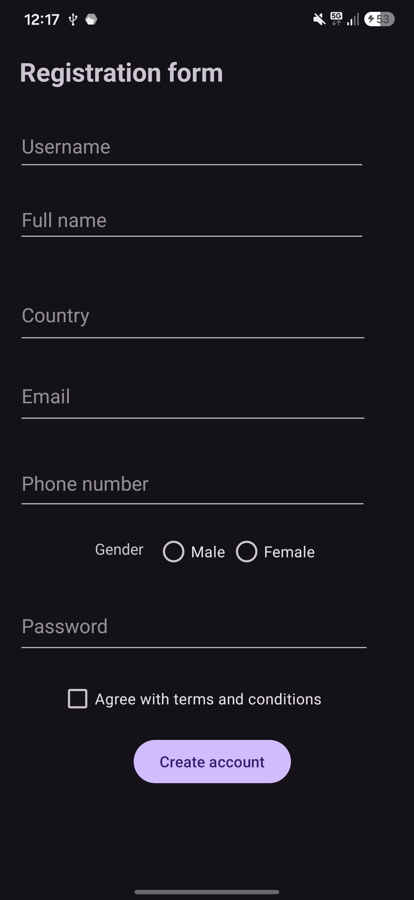
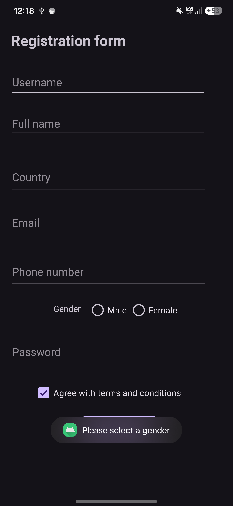
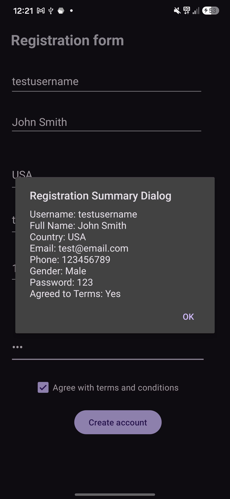

# Registration App

An Android application built in Java that provides a user registration form with input validation, accessibility support, and confirmation dialog summary.

## Features

- **Registration Form UI**: Built with `ConstraintLayout` supporting modern edge-to-edge display.
- **Input Fields**:
  - Username (with autofill hints)
  - Full Name
  - Country
  - Email Address (with email input type & autofill)
  - Phone Number (with phone input type & autofill)
  - Gender Selection (`RadioGroup` ensuring exclusive choice between Male and Female)
  - Password (secure text entry & autofill)
  - Terms & Conditions Agreement (`CheckBox`)
- **Validation**: Ensures all fields are filled and a gender is selected before account creation (displays a validation `Toast` if gender is missing).
- **Summary Dialog**: On successful validation, displays an `AlertDialog` summarizing the entered registration details.
- **Localization**: Uses Android string resources (`strings.xml`) for all UI text labels and hints.

## Screenshots

|                    Registration Form                    |                   Validation Toast                    |                  Summary Dialog                   |
|:-------------------------------------------------------:|:-----------------------------------------------------:|:-------------------------------------------------:|
|  |  |  |

## Project Structure

- `app/src/main/java/com/example/registrationapp/MainActivity.java`: Main activity handling form validation, click listeners, and summary dialog generation.
- `app/src/main/res/layout/activity_main.xml`: XML layout file defining the registration form UI components and constraints.
- `app/src/main/res/values/strings.xml`: Centralized string resources.

## Requirements

- Android SDK (API 24+)
- Android Studio
- Gradle Build System

## Getting Started

1. Clone or open the project repository in **Android Studio**.
2. Sync the project with Gradle files.
3. Run the app on an Android Emulator or physical device.
